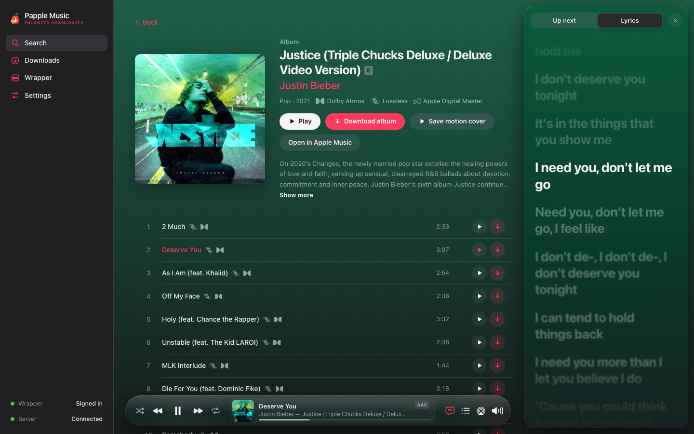
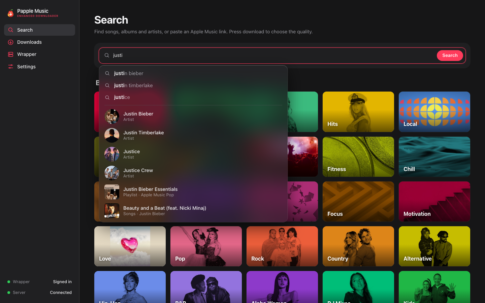
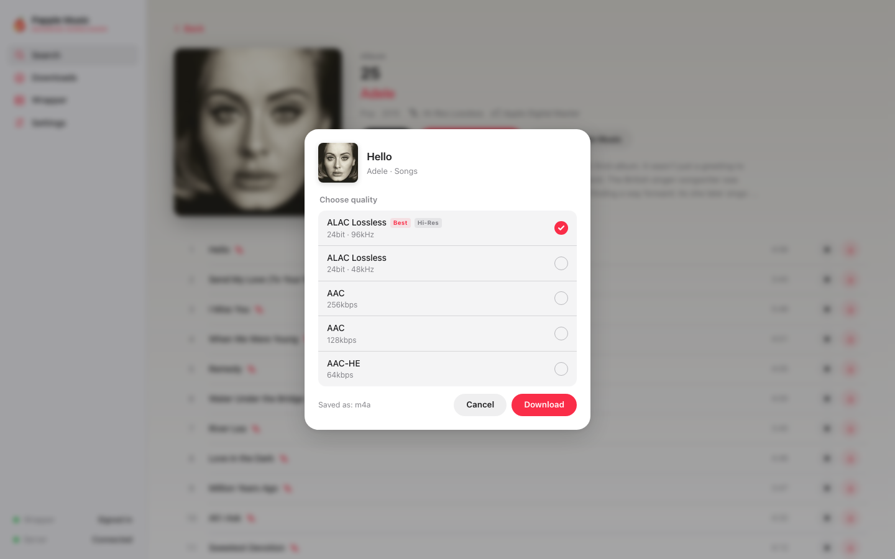
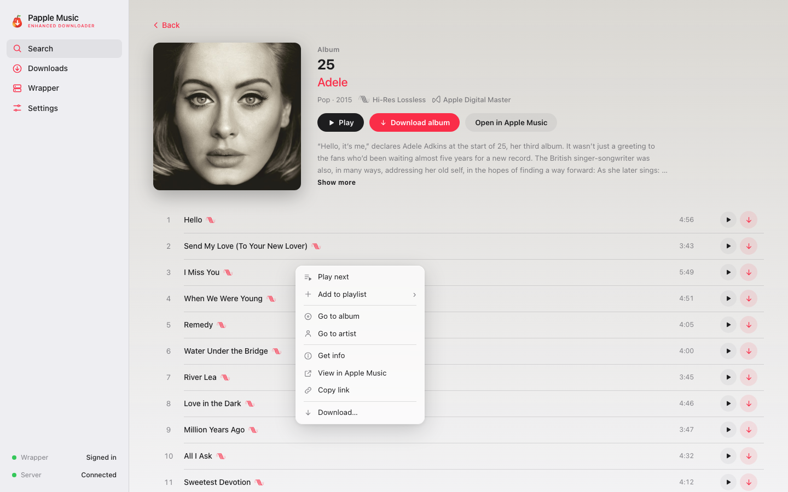
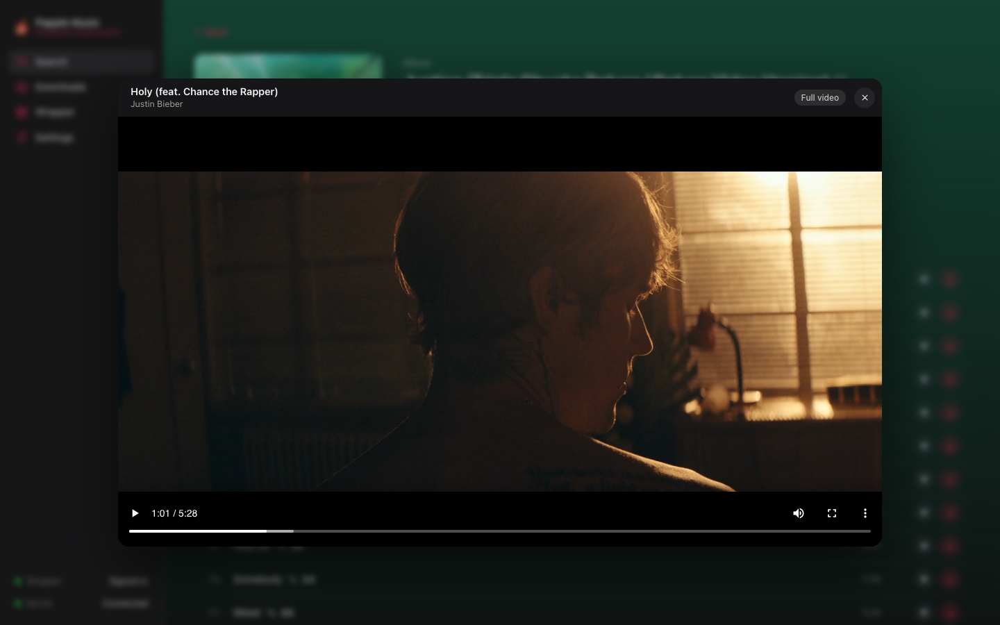
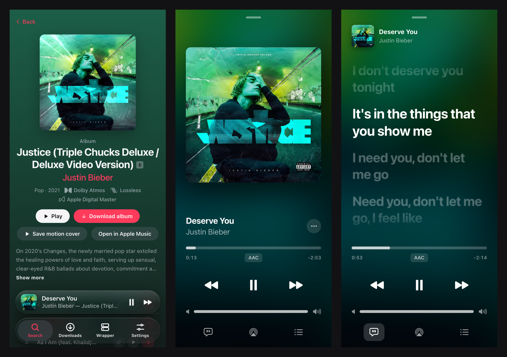

<p align="center">
  
</p>

<h1 align="center">Papple Music</h1>

<p align="center">
  <b>A friendly, music-app style web GUI for <a href="https://github.com/glomatico/gamdl">gamdl</a></b><br>
  Search, preview and download from Apple Music in the exact quality you want
</p>

<p align="center">
  
  
  
  
  
</p>

<p align="center">
  
</p>

Papple Music is a self-hosted web app that puts a polished, Apple Music–like interface on top of [gamdl](https://github.com/glomatico/gamdl). Browse the catalog, listen before you download, pick ALAC Hi-Res, Dolby Atmos or AAC per song, and get perfectly tagged files — from your Mac, a Linux box, or a Synology NAS.

> [!NOTE]
> You need your own **active Apple Music subscription**. Papple Music is for personal use with your own account.

---

## Contents

1. [Features](#features)
2. [Screenshots](#screenshots)
3. [Requirements](#requirements)
4. [Quick start (5 minutes)](#quick-start-5-minutes)
5. [Signing in: cookies vs. wrapper](#signing-in-cookies-vs-wrapper)
6. [Setting up the wrapper (ALAC lossless)](#setting-up-the-wrapper-alac-lossless)
7. [How to use](#how-to-use)
8. [Settings](#settings)
9. [Docker and Synology NAS](#docker-and-synology-nas)
10. [Custom branding](#custom-branding)
11. [Security](#security)
12. [FAQ](#faq)
13. [Project layout](#project-layout)
14. [Credits, disclaimer and license](#credits-disclaimer-and-license)

---

## Features

### 🔎 Find
- **Search with suggestions** — type `justi` and get *justin bieber*, *justice* and top results right under the box. Arrow keys + Enter work too.
- **Paste a link** — an Apple Music link opens its album, playlist or artist page. Song links open the album and highlight the song.
- **Browse** — genre, chart and mood categories, recent searches, album / artist / playlist / curator pages, other versions and more by the same artist.
- **Looks great** — backgrounds tinted by the artwork, motion album covers, dark and light mode, Lossless · Hi-Res · Dolby Atmos badges.
- **English and Korean UI** — switch any time in Settings.

### ⬇️ Download
- **See the real quality before you download** — e.g. `ALAC 24-bit · 96 kHz`, `ALAC 24-bit · 48 kHz`, `Dolby Atmos 768 kbps`, `AAC 256 kbps`.
- **Convert to FLAC, WAV or MP3** — keeps 24-bit, tags, cover and lyrics.
- **Every tag, plus extras** — label, UPC, Apple Music link, Apple ID, language and explicit flag.
- **Covers, lyrics, playlists** — full-resolution artwork, synced lyrics (LRC), M3U8 playlists, motion covers (`Cover.mp4`).
- **A real queue** — add many at once, watch per-track progress and logs live, skip what you already have.

### ▶️ Listen and watch
- **Stream in the browser** — AAC 256 kbps or lossless (ALAC served as FLAC). The next song is prepared in advance.
- **A music-app player** — shuffle, repeat, scrubber, volume, AirPlay (Safari), up next and history.
- **Live lyrics** — synced lyrics that glide line by line; click a line to jump there.
- **Music videos** — play in a popup HLS player. A 30-second preview starts instantly and the full 1080p video takes over when it's ready.
- **Right-click menu** — play next, add to playlist, go to album or artist, get info, copy link, download.

### 📱 Anywhere
- **Phone layout** — tab bar, mini player, and a full-screen player that grows out of the mini player, with lyrics.
- **Always on** — run it in Docker on an x86 NAS such as Synology and use it from any device at home.

---

## Screenshots

| Search suggestions | Choose the quality |
| :---: | :---: |
|  |  |
| **Right-click menu** | **Music video popup** |
|  |  |

<p align="center">
  <br>
  <sub>On a phone — album page with the mini player → full-screen player → live lyrics</sub>
</p>

---

## Requirements

| You need | Why |
| --- | --- |
| **Apple Music subscription** | An active subscription on your own account. |
| **[uv](https://docs.astral.sh/uv/)** | Installs Python and all dependencies for you. |
| **[ffmpeg](https://ffmpeg.org)** | Conversion, video handling and quality checks. |
| **Docker** *(optional)* | Needed for the wrapper container that unlocks ALAC lossless. On macOS, [OrbStack](https://orbstack.dev) is recommended. |

Built and tested on macOS (Apple Silicon); Linux works too. A few buttons such as "Open in Finder" are macOS-only.

---

## Quick start (5 minutes)

**1. Install the tools** (macOS with [Homebrew](https://brew.sh))

```bash
brew install uv ffmpeg
```

**2. Get the code and run it**

```bash
git clone https://github.com/lewisysh/papple-music.git
cd papple-music
uv run papple-music --open
```

Your browser opens <http://127.0.0.1:8765>. That's it! 🎉

**3. Sign in** — searching and browsing work right away. To download and play, set up one of the [sign-in options](#signing-in-cookies-vs-wrapper).

> [!TIP]
> - Settings, cookies and caches live in `~/.gamdl-web/`; music is saved to `~/Music/gamdl/` by default (change it in Settings).
> - The UI follows your browser language. Switch between **English** and **한국어** at the top of the Settings page.
> - Next time, `uv run papple-music --open` is all you need.

---

## Signing in: cookies vs. wrapper

| Method | Qualities | Setup |
| --- | --- | --- |
| **Cookies / token** | AAC · AAC-HE · Dolby Atmos · music videos | **Settings → Apple Music cookies**: upload `cookies.txt` or paste your `media-user-token` |
| **Wrapper** | All of the above + **ALAC lossless (incl. Hi-Res)** | Run the wrapper container, then sign in with your Apple ID on the **Wrapper** tab |

Export `cookies.txt` from a browser signed in to music.apple.com with an extension such as *Get cookies.txt LOCALLY*.

> [!WARNING]
> Your `media-user-token` and cookie file are **as sensitive as a password**. Never post them in issues, chats or screenshots.
> Papple Music never shows them in logs or the UI and only stores them in `~/.gamdl-web/`.

---

## Setting up the wrapper (ALAC lossless)

[wrapper-v2](https://github.com/glomatico/wrapper-v2) runs the Apple Music Android libraries in a container to decrypt ALAC streams.

1. **Start Docker** — install and open [OrbStack](https://orbstack.dev) (recommended on macOS) or Docker Desktop.
2. **Get the APK** — obtain the Apple Music Android APK **`3.6.0-beta-1109`** yourself *(it is not included here)*. Other versions are rejected by the hash check.
3. **Run the setup script**

   ```bash
   ./scripts/setup-wrapper.sh ~/Downloads/AppleMusic_3.6.0-beta-1109.apk
   ```

   It fetches wrapper-v2, extracts and verifies the libraries, builds the image and starts the container. The first build can take 10+ minutes.
4. **Sign in** — on the **Wrapper** tab, sign in with your Apple ID and enter the 2FA code. The session is kept in `data/wrapper/`, so it survives restarts.
5. **Done** — ALAC options now appear in the download window.

> The wrapper only listens on `127.0.0.1:8080` (HTTP) and `127.0.0.1:10020` (decrypt). To change the ports, set `WRAPPER_HTTP_PORT` / `WRAPPER_DECRYPT_PORT` and update the addresses in Settings.

---

## How to use

<details open>
<summary><b>🔎 Search and browse</b></summary>

- Type a song, album or artist name. After a few letters, **suggestions** and top results appear.
- Use the tabs above the results (All · Songs · Albums · Artists · Playlists · Music videos) to narrow them down.
- **Paste an Apple Music link** to jump straight to its page. Paste several links (one per line) to queue them all at once.
</details>

<details>
<summary><b>⬇️ Download</b></summary>

- Click the red **↓** next to a song → the qualities it actually offers appear → pick one and press **Download**.
- On album and playlist pages, **Download album** grabs everything.
- The **Downloads** tab shows progress, per-track status, logs, retry and **Open folder in Finder** (macOS).
</details>

<details>
<summary><b>▶️ Listen, lyrics and music videos</b></summary>

- Press **▶** to play. A song takes a few seconds the first time, then plays instantly.
- Click the `AAC` badge in the player to switch to **lossless streaming** (requires the wrapper).
- 💬 shows **lyrics**, ☰ shows **up next and history**.
- **▶** on a music video opens the **popup player**: the preview starts first and the full video replaces it when ready.

| Control | Action |
| --- | --- |
| `Space` | Play / pause |
| Right-click a song | Context menu |
| Hover the scrubber | Show times; click or drag to seek |
| Hover the volume icon | Open the volume slider |
| Phone: tap the mini player | Full-screen player (swipe down to close) |
</details>

---

## Settings

Everything important in gamdl can be changed on the Settings page. The file is `~/.gamdl-web/settings.json`.

| Setting | What it does |
| --- | --- |
| Output format | Original (m4a) · FLAC · WAV · MP3 (choose the bitrate); keep the original after converting |
| Codec priority | The order used when you don't pick a quality (e.g. ALAC → AAC) |
| Folder / file names | gamdl templates such as `{album_artist}/{album}/{track:02d} {title}` |
| Playlist path | Where songs downloaded from a playlist go |
| Cover | Format (jpg · png · raw), size (up to 10000), save as a file |
| Lyrics | Save synced lyrics (LRC), embed in tags |
| Tags | Choose exactly which tags are written (cover included) |
| Music videos | Max resolution, codec, container |
| Wrapper | Use by default, HTTP / decrypt addresses, container name |

<details>
<summary><b>Environment variables</b></summary>

| Name | Description |
| --- | --- |
| `GAMDL_WEB_HOST`, `GAMDL_WEB_PORT` | Server address (default `127.0.0.1:8765`). Also `--host` / `--port`. |
| `GAMDL_WEB_PASSWORD` | Enables HTTP Basic auth (any username). Required when listening on anything other than `127.0.0.1`. |
| `GAMDL_WEB_ALLOWED_HOSTS` | Extra host names allowed without a password (comma-separated) |
| `GAMDL_WEB_DATA_DIR` | Settings, cookies and caches (default `~/.gamdl-web`) |
| `GAMDL_WEB_UMASK` | Permissions for downloaded files (`000` on a NAS keeps them editable over SMB) |
| `GAMDL_WEB_<SETTING>` | Default for a setting when no settings file exists (e.g. `GAMDL_WEB_OUTPUT_PATH`) |
</details>

---

## Docker and Synology NAS

### Everything in containers on this machine

```bash
GAMDL_WEB_PASSWORD='a-long-password' docker compose --profile web up -d --build
```

Downloads go to `./downloads` (change with `GAMDL_WEB_DOWNLOADS=/path`), settings and cookies to `./data/web`. The port is only published on `127.0.0.1:8765`.

### Synology NAS (Intel / AMD models)

Runs in **Container Manager** on x86 Synology models such as the DS220+, DS920+ and DS923+. Build the images on your computer with your own APK, then upload them to the NAS.

```bash
./scripts/build-synology.sh ~/Downloads/AppleMusic_3.6.0-beta-1109.apk
# → dist/synology/  papple-music.tar · wrapper-v2.tar · docker-compose.yml (with a generated web password)
```

Apple sign-in and cookies start empty. Step-by-step instructions: **[deploy/synology/README.md](deploy/synology/README.md)**.

> [!IMPORTANT]
> `wrapper-v2.tar` contains the Apple libraries extracted from your APK. **Never upload it anywhere public.**

---

## Custom branding

Create a `brand/` folder inside the data folder to change the logo and name on your own screen — no code changes, and nothing is committed to git.

```
~/.gamdl-web/brand/
  brand.json      {"name": "My Music", "tagline": "Downloader"}
  mark.svg        Sidebar icon (next to the name)
  wordmark.svg    If present, shown instead of icon + name (single-color SVG)
  icon-64.png     Browser tab icon
  icon-128.png    Empty-state icon
  icon-180.png    Home screen icon (iPhone)
```

Missing files fall back to the Papple logo. With Docker, put the folder at `./data/web/brand/`.

---

## Security

Papple Music is designed as a **personal, local tool**.

- By default it only listens on `127.0.0.1`, so only this computer can reach it.
- `Host`, `Origin` and `Sec-Fetch-Site` checks stop other websites from driving the API through your browser. Without a password, only `localhost` / `127.0.0.1` hosts are accepted, which also blocks DNS-rebinding attacks.
- The settings API won't point ffmpeg or the cookie path at arbitrary programs or files.
- Tokens and cookies are redacted from logs (including DEBUG), events and API responses.
- "Open in Finder" only works inside the download folder.

**To use it from other devices (e.g. your phone):**

```bash
GAMDL_WEB_PASSWORD='a-long-password' uv run papple-music --host 0.0.0.0
```

> [!CAUTION]
> Always set a password with `--host 0.0.0.0` (the server refuses to start without one).
> Don't expose it to the internet directly — keep it on your home network or behind a VPN such as Tailscale.

---

## FAQ

<details>
<summary><b>I don't see ALAC options</b></summary>

Check the Wrapper tab: the wrapper must be running and signed in, and the sidebar should say "Wrapper · Signed in". Without the wrapper, only Apple's catalog data is available, so Hi-Res above 48 kHz may be missing.
</details>

<details>
<summary><b>Downloads fail or ask for cookies</b></summary>

Re-upload `cookies.txt` or paste a fresh `media-user-token` in Settings. Tokens expire after a few months. Also make sure your subscription is active.
</details>

<details>
<summary><b>The first play is slow</b></summary>

Browsers can't play Apple's encrypted streams, so the server downloads and decrypts a song the first time you play it: about 3–8 s for AAC, ~10 s for lossless and ~20 s for a music video. After that it plays from the cache (`~/.gamdl-web/stream/`).
</details>

<details>
<summary><b>The wrapper build fails the hash check</b></summary>

Make sure the APK is exactly version `3.6.0-beta-1109`. `.apkm` bundles are supported.
</details>

<details>
<summary><b>The AirPlay button doesn't work</b></summary>

Web pages can only open the AirPlay picker in Safari. In Chrome, use Cast instead.
</details>

<details>
<summary><b>"Too many requests to Apple Music"</b></summary>

Apple briefly rate-limits bursts of requests. Wait a minute and try again.
</details>

---

## Project layout

```
gamdl_web/
  app.py           FastAPI routes, middleware (auth · origin checks), SSE
  jobs.py          Download queue, per-track state, conversion and tag post-processing
  runner.py        Settings → gamdl API / downloader setup
  search.py        Catalog search, suggestions, detail pages, lyrics, library
  formats.py       Per-song available qualities (wrapper HLS → catalog)
  convert.py       ffmpeg conversion and tag copying (FLAC / WAV / MP3)
  stream.py        Preview and music video cache (AAC / lossless / HLS)
  motion.py        Motion album covers
  prompts.py       gamdl's interactive questions → browser dialogs
  wrapper.py       wrapper-v2 HTTP API proxy (tokens never reach the browser)
  docker_ctl.py    Container control via the docker CLI
  static/          Web UI (plain HTML / CSS / JS, no build step; i18n.js, hls.js)
scripts/
  setup-wrapper.sh     Build and start wrapper-v2
  build-synology.sh    Build images for x86 NAS
deploy/synology/       Compose file and guide for Synology
compose.yaml           Wrapper (+ optional web UI) containers
```

When working on the UI, keep the server running, edit files in `gamdl_web/static/` and reload. Restart the server after changing Python code. UI text is written in Korean in the code and translated by `static/i18n.js`; add new phrases there.

---

## Credits, disclaimer and license

**Built on**
- [glomatico/gamdl](https://github.com/glomatico/gamdl) — the download engine
- [glomatico/wrapper-v2](https://github.com/glomatico/wrapper-v2) — ALAC decryption container
- [FastAPI](https://fastapi.tiangolo.com) · [mutagen](https://github.com/quodlibet/mutagen) · [ffmpeg](https://ffmpeg.org) · [hls.js](https://github.com/video-dev/hls.js) (Apache-2.0)

**Disclaimer**

Papple Music is not affiliated with, endorsed by or sponsored by Apple Inc. Apple Music, AirPlay and Apple Digital Master are trademarks of Apple Inc.; Dolby Atmos is a trademark of Dolby Laboratories. "Papple" is the name of a pear–apple hybrid fruit. 🍐🍎

**Use it only with your own subscription and for personal use.** Don't distribute or share downloaded music. You are responsible for following the copyright laws where you live and the Apple Media Services Terms and Conditions.

**License** — [MIT](LICENSE)
